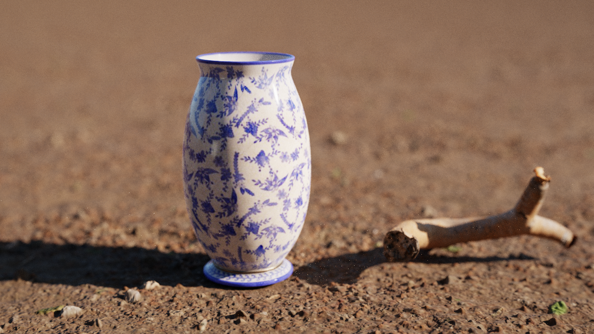

# Prism

A WebGPU path tracer written from scratch. No three.js or third-party BVH.
The render page image is computed in real time by the browser; gallery covers are static preview images.



## What to look at

The home page is a gallery with one card per scene; clicking through opens a page of real-time rendered imagery. Visitors do not need to tune any parameters —
composition, lighting and materials are all fixed in the scene.

| | |
|---|---|
| **Wasteland** | A blue-and-white porcelain vase sits on sand under the setting sun, with a dried branch lying at the lower right. The ground is made of 3 × 3 displaced tiles covering about 6.33 m square; the surface relief is real geometry and takes part in intersection and shadows. Depth of field is currently off in this scene to reduce out-of-focus noise. |

The render page has a link back to the gallery at the top-left. Rendering runs in a Worker; the main thread only displays. Drag with the left button to orbit,
scroll to zoom, drag with the right button to pan.

## Running it

```bash
npm install
npm run dev        # http://localhost:5173
```

Requires a browser with WebGPU support: **Chrome / Edge 113+**, or **Safari 18+**.
Firefox needs `dom.webgpu.enabled`. When unsupported it falls back to a static page — the rendered image and
some explanation, so at least it isn't a blank screen.

## AI workbench

The "Tune scene with AI" control in the top-right of the "Emissive Panel" scene accepts text commands, such as "make the lamp dimmer."
For local use, set `VITE_PUBLIC_DEEPSEEK_API_KEY` in `.env.local` at the repo root, then restart `npm run dev`.
GitHub Pages uses a GitHub Actions repository variable of the same name; re-run the deploy workflow after setting it.
This variable is bundled into the public page, so it is suitable only for a credential dedicated to public demos. When it is not configured, the gallery still works normally.

## What's implemented

**Intersection**
- Two-level BVH (TLAS / BLAS), built on the CPU and flattened into a 1D buffer, traversed iteratively on the GPU
- Möller–Trumbore triangle intersection; intersecting in local space keeps `t` unchanged when an instance is scaled

**Lighting**
- NEE: the environment map is importance-sampled by a brightness CDF; if the shadow ray is visible, radiance from that direction is taken directly
- MIS: BSDF sampling and light sampling are combined with the power heuristic
- Russian roulette: after the 4th bounce, terminate by survival probability
- Progressive accumulation: 1 spp added per frame, never reset while the camera and parameters stay put

**Other**
- Environment map importance sampling (2K EXR); the in-project decoder handles uncompressed, ZIPS and ZIP single-part scanline EXR with half / float RGB channels
- glTF 2.0 import (both `.gltf` with external assets and single-file `.glb`);
  that is how the porcelain vase and dried branch in the scene got in
- Thin-lens depth of field: aperture radius + focus distance, both in meters; the primary ray starts from a point on the pupil disk
  and aims at the same point on the focal plane; this effect is currently off in the scene
- Displacement maps are baked into real geometry (tessellation + vertex displacement) that enters the BVH for intersection and shadows; the resulting material
  carries no displacement field, so the shader doesn't know it exists
- Material maps go through `texture_2d_array`: four arrays for diffuse / normal / roughness / ambient occlusion,
  each with a full mip chain; glTF's packed metallicRoughness map goes into the roughness array as-is,
  with the G channel read as roughness and the B channel as metalness (Poly Haven's arm maps follow the same layout)
- Each frame samples only part of the screen, with dispatch size adapting to measured GPU time; the order table guarantees
  every round covers every pixel exactly once, so the denominator of the accumulated average needs no per-pixel storage

## What's not done

Stating the boundaries clearly is more useful than a feature list:

- **glTF accepts only triangles and four texture types**. Draco / meshopt compression, skinning, animation and morph are all unsupported
  (Draco reports an explicit error)
- **No transparency / alpha cutout**. Models that rely on alpha cutouts, like leaves and sheer curtains, render as solid sheets
  (the material IR doesn't even keep an alpha field; supporting it would mean adding it back all the way from glTF import)
- **Smooth glass**: refraction, Fresnel reflection and total internal reflection are supported; rough transmission, volumetric absorption and dedicated caustic sampling are not yet.
- **The BVH uses 16-bucket SAH binning across three axes**; beyond depth 40 it falls back to median split,
  leaving headroom for the shader's 64-level traversal stack. Leaves hold at most 2 primitives
- **Emissive geometry** uses area sampling and MIS. glTF supports emissiveFactor and emissiveStrength; emissive maps and separate point lights are not yet supported.

## Structure

Dependencies point one way; the further down, the less a layer knows about the layers above it:

```
src/app/               routing, gallery, render page, fallback page, scene catalog and assembly
src/core/api/          Prism facade, main-thread RPC and three handles
src/core/worker/       Worker entry and render implementation
  camera/              frame loop, path tracing, display
  background/          environment maps and brightness CDF
  model/               glTF, materials, image decoding, meshes and BVH
src/core/math/         vectors, matrices, colors
```

Path tracing runs entirely in the Worker: `Prism.create()` spawns a Worker and requests a dedicated `GPUDevice`.
The main thread never touches the GPU and only receives `ImageBitmap` frames via `camera.listen()`. `src/core/worker/worker.ts`
assembles the camera, background and models; scene definitions and load order stay in the app layer.

About 8,800 lines of TypeScript + WGSL + CSS.

### Adding a scene

Add the camera placement, environment map, geometry list and card info to `SCENE_CARDS` in `src/app/catalog.ts`;
extend the assembly logic in `src/app/assemble.ts` as needed, then add a cover at `assets/gallery/<key>.png`.
Routing, the gallery and the fallback page all pick it up automatically.

## Where the scenes come from

Models, textures and environment maps all come from **Poly Haven** (CC0): downloaded models and materials go into
`assets/model/` and `assets/textures/`, environment maps (EXR) into `assets/env/`.
Model placement and framing live in `src/app/catalog.ts`; the renderer knows nothing about specific scenes.

Large-scale geometry such as the ground is generated by `src/app/ground.ts`; the displacement map is attached to the material, the mesh is tessellated into real geometry at compile time,
vertices are lifted and normals recomputed from the height field, and the map is consumed before it ever reaches the GPU.

## License

MIT
